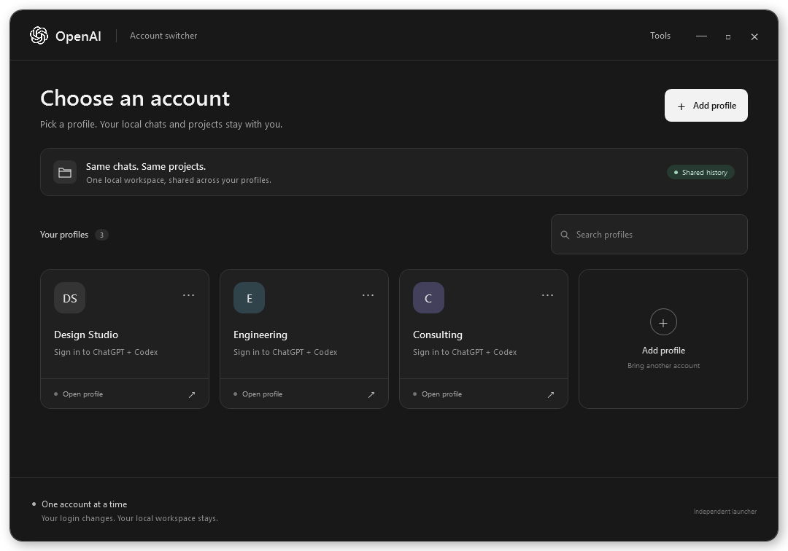
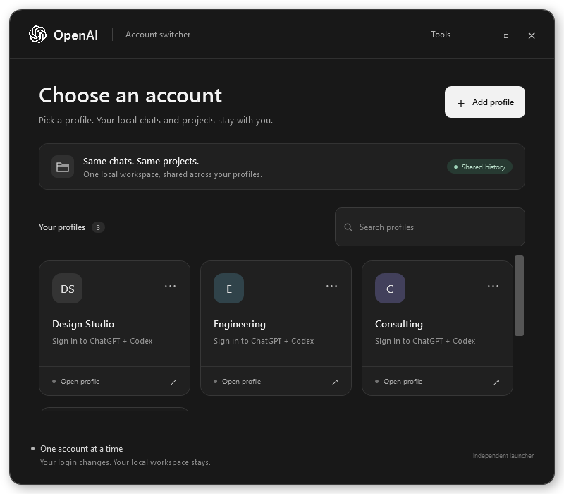
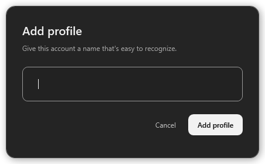

<div align="center">

# ChatGPT & Codex Account Switcher for Windows

**Multiple accounts. Separate saved logins. One shared local workspace.**

An independent Windows launcher for native ChatGPT / Codex account profiles, switching one account at a time, and sharing local Codex chats and projects.

[](https://github.com/harshjamdar/chatgpt-codex-account-switcher/releases/latest)
[](https://github.com/harshjamdar/chatgpt-codex-account-switcher/releases)


**[Download for Windows](https://github.com/harshjamdar/chatgpt-codex-account-switcher/releases/latest)** · [Installation](#installation) · [Screenshots](#screenshots) · [FAQ](#frequently-asked-questions) · [Report a bug](https://github.com/harshjamdar/chatgpt-codex-account-switcher/issues/new/choose)

</div>



## Switch work accounts without repeated sign-outs

Working across several organizations can mean repeatedly signing out and back in. This launcher gives each account its own native login home and browser session, then opens your installed app with the selected profile.

Organize company or personal profiles, keep recognizable account names, and switch accounts while retaining a common local Codex workspace. There is no fixed profile limit; practical limits depend on your machine.

**This is a native-app launcher, not a web wrapper.** It does not bundle ChatGPT or Codex, provide a subscription, or merge cloud accounts. Compatibility was tested with the installed `OpenAI.Codex` package version `26.1117.3838.0`; other native packages and future versions require compatibility verification.

## Features

| Capability | What you can do |
| --- | --- |
| Multiple account profiles | Add with **+**, rename, remove and restore profiles. |
| Saved native logins | Keep separate account homes and browser sessions. Sign in on first use. |
| One account at a time | Queue the next profile, request a normal close, or cancel a switch. |
| Shared local chats and projects | Point profiles at the same local Codex SQLite store. |
| Profile customization | Set colors and logos, favorite accounts, search and reorder cards. |
| Fast access | Create stable desktop shortcuts and use the tray or keyboard shortcuts. |
| Account checks | Set expected email/workspace guards and inspect native-service identity. |
| Troubleshooting | Check compatibility, verify shared history, retry launches and export filtered diagnostics. |
| Recovery | Create SQLite snapshots and validate restores with failure recovery. |
| Per-user installation | Install without an administrator account; retain a previous installer-managed version for rollback after upgrading. |

## Screenshots

Actual v5.1 launcher renders using demonstration profiles; no real account details are shown.

<table>
<tr>
<td align="center" width="65%">

<br><strong>Compact profile picker</strong>
</td>
<td align="center" width="35%">

<br><strong>Add a profile with +</strong>
</td>
</tr>
</table>

## Installation

### 1. Check the requirements

- A Windows desktop with .NET Framework and WPF available.
- A compatible native ChatGPT / Codex installation. Install the native app separately first.
- Permission to use the selected accounts and share local data across them. Company workspace restrictions still apply.

### 2. Choose your download

Open the **[latest release](https://github.com/harshjamdar/chatgpt-codex-account-switcher/releases/latest)** and expand **Assets** if necessary.

| File | Choose this when… |
| --- | --- |
| **`OpenAIProfiles-Setup.exe`** | You want the recommended per-user installation with Desktop and Start menu shortcuts. |
| `OpenAIProfiles-V5.1.1.exe` | You want to run the portable launcher without installing it. |
| `OpenAIProfiles-V5.1.1-Package.zip` | You want the app, installer, source/build files and documentation together. Extract it before use. |
| `SHA256SUMS.txt` | You want to compare download checksums. |

**Download an EXE under Assets, rather than GitHub's automatically generated “Source code” archive, to run the app.**

The current release is **unsigned**, so Windows may show a publisher or SmartScreen warning. Signing was deferred for this release. A checksum confirms that a file matches the published download; it is not a trusted publisher signature. Managed company computers may block unsigned apps.

<details>
<summary>Optional: check a download's SHA-256 checksum</summary>

In PowerShell, from the folder containing your download:

```powershell
Get-FileHash .\OpenAIProfiles-Setup.exe -Algorithm SHA256
```

Compare the result with the matching filename in the release's `SHA256SUMS.txt`.

</details>

### 3. Install and open the launcher

1. Close any older launcher window.
2. Run **`OpenAIProfiles-Setup.exe`** and select **Install / update**.
3. Select **Open launcher**, or use the **OpenAI Profiles** Desktop / Start menu shortcut. The current app and shortcut labels use this shorter name.

For portable use, open `OpenAIProfiles-V5.1.1.exe` directly. Portable mode still saves profile data under your Windows user account; it does not keep credentials beside the EXE.

### 4. Add your first account

1. Fully quit your native app, including its tray icon. Close Codex CLI and IDE sessions too.
2. Click **+ Add profile** and enter a recognizable name, such as “Design Studio”.
3. Select the profile to open the installed native app.
4. Complete sign-in yourself inside the native app on first use.
5. Repeat for your other accounts, quitting the current native sessions before opening the next profile.

### 5. Switch accounts

Select another profile. If a native account is already running, the launcher queues your selection. Use **Request close & switch** to request a normal close, or quit the native app yourself. If it remains in the tray, choose **Quit** there. The next profile opens after the current native sessions exit.

**SafeKill & switch** is available for a stuck queue. It asks for confirmation, tries a normal close, then force-stops only captured native processes whose identity still matches. Unsaved work and running tasks can be lost; an open Codex chat will disconnect. It does not delete saved login or history files. Newly started sessions are left running and keep the switch queued.

Without SafeKill confirmation, the launcher does not force-close ongoing work. **Cancel switch** clears the pending account. Its single-account guard applies to launches made through this utility; it cannot prevent sessions started directly elsewhere.

## How shared local chats and projects work

| Shared across profiles | Kept separate |
| --- | --- |
| Local Codex SQLite chat/project state, normally in your existing user `.codex` folder | Each profile's native login home, configuration and browser session |

**Cloud ChatGPT chats and cloud Projects remain associated with their accounts.** Local sharing does not change conversation ownership, subscriptions, company permissions or account-specific access.

Rollout files and attachments remain in their original profile folders. **Do not manually delete those folders**: shared history can reference them. Removing a profile in the launcher hides it and retains its data.

Preexisting private history or a conflicting `sqlite_home` configuration blocks launch rather than silently hiding data. SQLite snapshots are not a complete backup of attachments, rollouts or credentials. Restore requires native clients to be closed.

## Troubleshooting

| Problem | What to check |
| --- | --- |
| Profile stays queued | Fully quit native windows, tray apps, Codex CLI and IDE sessions. Use Cancel switch if needed, or explicitly confirm **SafeKill & switch** after saving your work. |
| Profile does not open | Use **Tools → Native compatibility check**, review the launch error, then retry. A native-app update can change compatibility. |
| The wrong account appears | Inspect the profile's Identity & workspace settings and sign-in inside the native app. Optional expected-identity guards can block mismatches. |
| Local chats or projects look different | Verify the shared store and run **Verify shared history**. Cloud history and account permissions remain separate. |
| Removed profile is missing | Use Restore profiles to show it again. Removal retains its folder. |
| Global shortcut does not work | The picker tries Ctrl+Alt+O, then Ctrl+Alt+Shift+O if occupied. Tools shows the registered shortcut. |

Need help? **[Open a bug report](https://github.com/harshjamdar/chatgpt-codex-account-switcher/issues/new/choose)** with the launcher/native-app versions, steps and error message. Omit login tokens, private chats and company data. The launcher offers filtered diagnostics for reporting.

## Frequently asked questions

### Can I use multiple ChatGPT or Codex accounts on Windows?

The launcher manages multiple saved native profiles and opens one account at a time. First-use authentication happens in the native app. Compatibility and organization policies determine whether a particular account works.

### Does it run three accounts simultaneously?

No. Account switching waits for the current native sessions to exit before opening the next profile.

### Does it share ChatGPT cloud conversations?

No. Sharing applies to local Codex SQLite state. Cloud ChatGPT chats and Projects remain account-bound.

### Does it need another Windows user or a browser wrapper?

No additional Windows user is required. The launcher opens your compatible installed native app with profile-specific settings.

### Can I restore a removed profile?

Yes. Removal hides the profile while retaining its folder and saved login. Use Restore profiles to bring it back.

### Is this an official OpenAI feature?

No. This is an independent project and is not affiliated with or endorsed by OpenAI.

## v5.1.1: SafeKill for stuck switches

Added an explicit force-quit action for queued switches, with an unsaved-work warning, captured PID/start-time/executable checks, normal-close grace period and a fresh one-account guard before opening the next profile. Focused checks terminated only scratch processes; cancellation retained all existing native sessions. See [SafeKill test results](SafeKill-test-report.txt).

## Validation and known limits

**88 checks passed** across core regression, native integration, launcher UI and installer suites, plus final build checks. [Read the detailed test report](Test-report.txt).

Native signed-out profiles opened in A → B → A order. The installed backend read and resumed shared synthetic chats across distinct test credential homes and listed more than 100 projects. Existing user app processes were retained.

Real company sign-in, SSO and account-specific conversation access still require manual verification. No company sign-in or real model request was made during testing. Desktop profile startup includes internal behavior that can change with app updates.

## Build from source

Clone this repository and run Windows PowerShell in its directory:

```powershell
.\Build-Launcher.ps1
```

The script uses the Windows .NET Framework C# compiler and WPF assemblies. It produces `OpenAIProfiles-V5.exe` (file version 5.1.1.0) and `OpenAIProfiles-Setup.exe`. The portable release download is named `OpenAIProfiles-V5.1.1.exe` and matches the build output.

The `tests/` directory contains development harness sources. Some require isolated fixtures and the compatible installed app; they are not a standalone one-command suite. Never run restore tests against a live store.

Signing is currently deferred. `Sign-Release.ps1` supports an existing Windows certificate-store signing identity. Trusted in-app update downloads also require HTTPS hosting and a pinned publisher; that successful path has not been tested without the infrastructure.

## Support the project

If this helps your workflow, star the repository or share the [release page](https://github.com/harshjamdar/chatgpt-codex-account-switcher/releases/latest). Feature ideas and reproducible bug reports are welcome through [Issues](https://github.com/harshjamdar/chatgpt-codex-account-switcher/issues).

OpenAI, ChatGPT and Codex names and branding belong to their respective owners. Included branding assets originate from the installed app and are not covered by a project license grant.
